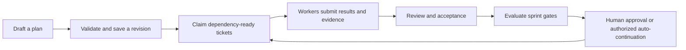

# DarkMechanicus

**Structured planning and execution for coding agents, with inspectable state and explicit human control.**

DarkMechanicus combines an Electron desktop app, a headless MCP server, and a CLI over one TypeScript command layer. People review plans and outcomes; agents claim dependency-ready work, submit evidence, and advance through the saved plan under its authorization rules.

[Download a release](https://github.com/davgor/DarkMechanicus/releases/latest) · [Bannerlord case study](docs/case-studies/bannerlord.md) · [Architecture](docs/architecture.md) · [Operating guide](docs/project-guide.md)

## Why it exists

Following an agent's changes through an unfamiliar C++ world generator became difficult to manage through conversation alone. DarkMechanicus makes the work explicit: versioned plans, dependencies, acceptance criteria, ticket ownership, execution history, and approval checkpoints.

The repository uses DarkMechanicus to develop DarkMechanicus. Its [plans and run history](.darkmechanicus/) travel with the code. A separate application integrated the [FWGC++ generator](https://github.com/davgor/FWGC-) into [Mount & Blade II: Bannerlord](https://github.com/davgor/MNBL-modding-repo), with recorded in-game campaign and save/load acceptance evidence. [Read the case study and its limits](docs/case-studies/bannerlord.md).

## How execution works



Execution reads a saved revision rather than a changing draft. The desktop, MCP server, and CLI use the same command rules. Human checkpoints require approval; automatic continuation requires explicit authorization. Headless access does not grant an agent permission to approve its own checkpoint.

## Engineering decisions worth inspecting

| Decision | Purpose | Evidence |
| --- | --- | --- |
| Shared command and authorization layer | Keep transport adapters from implementing different business rules | [Architecture](docs/architecture.md), [command capabilities](src/core/commands/capabilities.ts) |
| SQLite execution state; portable Git records in repository mode | Coordinate local processes while keeping plans and history inspectable alongside code | [Storage decision](docs/decisions/0001-sqlite-driver.md), [storage modes and tradeoffs](docs/decisions/0002-storage-modes.md) |
| Transactional ticket claims | Prevent competing local workers from both owning the same ticket | [Multi-process claim stress harness](scripts/spike/claim-stress.ts) |
| Approval bound to the reviewed result | Tie a one-use grant to the run, revision, sprint, report, and action; refuse stale reports | [Checkpoint implementation](src/core/services/checkpoints.ts), [grant tests](src/core/services/checkpoints.grants.test.ts) |

This is a local coordination platform, not evidence of a distributed, multi-tenant execution fleet. Git-portable records and machine-local runtime state have different lifecycles; the [architecture](docs/architecture.md) documents those boundaries, recovery behavior, and trust limits.

## Try it

1. Install a [Windows or macOS release](https://github.com/davgor/DarkMechanicus/releases/latest). macOS builds are not notarized; read the [first-launch instructions](docs/runbooks/auto-update.md#first-launch-on-macos).
2. Track a project folder and choose repository-backed or database-only storage.
3. Connect an [MCP agent host](docs/runbooks/mcp-setup.md), use the [CLI](docs/runbooks/cli.md), or configure a [hosted agent](docs/runbooks/agents.md).
4. Draft and save a small plan, run it, and inspect the submitted evidence at its checkpoint.

See the [operating guide](docs/project-guide.md) for setup details, source control, provider configuration, planning workflows, and release behavior. Agent runtimes and their authentication are configured separately; downloading the app does not supply model access.

## Develop and verify

Read [AGENTS.md](AGENTS.md) before making changes. With Node.js 24 and npm:

```sh
npm ci
npm run dev
```

The verification gate includes lint, type checking, unit tests, dead-code checks, and a production build. CI also runs Fireguard test-quality checks; see the [full commands and CI contract](docs/project-guide.md#ci). Targeted executable probes include:

```sh
npm run build
npm run smoke:mcp       # exercise the built MCP server over stdio
npm run spike:claims    # competing claims across OS processes
```

Further reading: [product contract](docs/product-plan.md), [architecture](docs/architecture.md), [agent role guides](skills/), [multi-repository folders](docs/runbooks/multi-repo-folders.md), [knowledge layers](docs/runbooks/knowledge.md), [scorecards, the Metrics dashboard and corrective work](docs/space-grading.md) ([corrective work runbook](docs/runbooks/corrective-work.md)).
