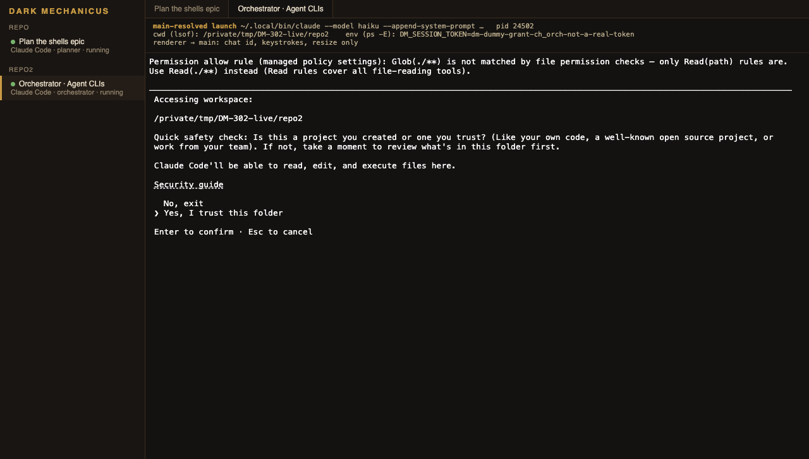

# Chats as terminal shells

Design spike for DM-302 ("Design chats as terminal shells that run the agent CLI directly"), epic "Agent CLIs", sprint 3. It answers the ticket's five questions, says what the prototype showed, and ends with the build tickets.

**The person's direction (2026-10-30).** Turn chats into shells, so the person works with the agent CLI directly. The protocol adapters (ACP, Codex app-server, Claude Code SDK) sit in the middle and make chats inflexible. The terminal lives **inside the app's main window**, in the place of the chat view, not in a separate window.

**How claims are marked.** *Verified (prototype)* means it ran on this Mac during the spike (macOS 25.6, arm64, Electron 42.11.9, node-pty 1.1.0, @xterm/xterm 6.0.0, Claude Code 2.1.291). *Verified (code)* means it was read in this repository at `bc01afd`. *Verified (help)* means the installed CLI's `--help` says so, but the flag was not exercised. *Inference* is everything else: it is what the build tickets must check first.

## Decisions at a glance

| Question | Recommendation |
|----------|----------------|
| 1. Terminal | `node-pty` 1.1.0 in the main process behind a small `PtyHost` interface, `@xterm/xterm` 6 with the fit and WebGL addons in the renderer. The terminal replaces `ChatView` in the app's main area (`app-main`); one terminal is mounted at a time and switching chats keeps every PTY running in main. |
| 2. What the shell runs | Only the chat's agent CLI, from a launch spec main builds from its own records. No general shell, ever. The renderer names a folder and a chat id once, then sends bytes and a size. |
| 3. Carry-over | Folder pinning, grant, instructions, per-folder default, quit disposal: kept, moved to CLI flags and environment. Approvals, sign-in prompts and model switching: left to the CLI. Resume: the CLI's own (`claude --session-id`/`--resume`, `a8s resume`, `codex resume`). Transcripts: the app stops storing them; old ones stay readable. |
| 4. Adapters | Removed: no streaming, approvals, transcript mapping or protocol handshake is left. What survives is not an adapter: a per-kind table of CLI flags. |
| 5. Testing | Pure launch-spec and IPC-validation unit tests; a fake `PtyHost` for lifecycle; a real PTY test with a fixture CLI under system Node; end to end on the built app over CDP on macOS and Windows. |

## What the app does today

From the code (*verified (code)*), so the carry-over below has a baseline:

- **Chats run through adapters.** `CHAT_ADAPTERS` (`src/main/agents/adapterRegistry.ts`) maps each protocol to an adapter: `claude.ts` drives the person's `claude` through the Claude Agent SDK, `codex.ts` runs `codex app-server` over JSON-RPC, and `acp/acpAdapter.ts` runs ACP agents (Cursor, Autonomous with `start {folder} --mode acp --approval-mode always-ask`, and custom ACP CLIs). Each adapter turns the vendor's messages into `ChatItem`s, raises approval requests and reports the vendor session id.
- **Launch specs come from the registry.** `launchSpecFor` (`launchSpec.ts`) takes the executable from the `agents` row (set by Find's native dialog, the installer or Add a custom CLI) and the arguments from a built-in preset or the custom row; `withFolder` replaces a whole `{folder}` argument. The renderer never supplies a path.
- **The folder is pinned.** `resolveLaunchFolder` (`launchFolder.ts`) refuses a folder that is gone, not a directory, not its own real path, or no longer tracked; the checked path is the process cwd, the protocol workspace, `{folder}` and the `dm` command's `--repo`. The adapter calls `checkFolder` again before each process it starts, and `stoppedForFolder` stops a live agent at its next turn when the folder moved.
- **Grant and instructions.** `createChatGrants` (`chatGrants.ts`) issues a grant at the chat's role (12 hours, `CHAT_GRANT_MINUTES` in `bootstrap.ts`) and puts it in the agent's environment as `DM_SESSION_TOKEN`, next to the `dm` invocation `buildCliConfig` makes (`node <app>/out/main/cli.js --repo <folder>`, or the app executable with `ELECTRON_RUN_AS_NODE=1` when packaged). `cliInstructions` tells the agent the exact command; it goes in Claude's appended system prompt, Codex's `developerInstructions` and the head of an ACP agent's first prompt. The grant is revoked when the session is disposed.
- **Sign-in.** `agentAuth.ts` runs each CLI's own status command (`claude auth status`, `codex login status`, `agent status`, `a8s doctor`) and classifies it; Sign in opens a separate terminal window (macOS Terminal through `osascript`, a `cmd.exe /k` console on Windows) running the CLI's login. In a chat, an adapter that sees an expired login stores `auth_required`, flags the agent signed out, and pauses a run the chat orchestrates with the reason `signed_out`.
- **Custom CLIs.** `customAgent.ts`: a strict payload (name, protocol, up to 32 arguments, no control or formatting characters), the program from a native dialog, `planCliLaunch`, a native confirmation that lists every argument, then a protocol handshake in an empty temp folder before the row is written.
- **Idle stop and quit.** A session with no turn and no waiting approval for 10 minutes is disposed and its next message resumes the vendor session (`sessionManager.ts`). `quitDisposal.ts` holds the first quit until every adapter's `dispose` has killed its process tree (`processTree.ts`: SIGKILL to the process group, `taskkill /t /f` on Windows), for at most 5 seconds.
- **Start run.** `startOrchestratorRun` queues the run, creates an `orchestrator` chat titled `Orchestrator · <epic>` with `runId`, and sends a kickoff message that carries the orchestrator and worker guidance (`orchestratorKickoff.ts`).
- **Transcripts and panels.** `chatStore.ts` keeps `index.jsonl` and one `<chat id>.jsonl` of masked `ChatItem`s per chat. `activityBindings.ts` binds threads to runs and attempts from the Dark Mechanicus calls in those items; a ticket's Activity tab and the run's Orchestrator feed read them with `chats:read`.
- **Renderer to main.** `window.dm.chats.*` (`src/preload/index.ts`) invokes `chats:*` channels that go through `guardIpc` (`src/main/ipcGuard.ts`: only the app's own top-level page); main pushes `chats:event` to every window. The main area renders one `ChatPane` keyed by chat id (`src/renderer/src/App.tsx`), so switching chats unmounts the view.

## The prototype

A throwaway Electron app in `/tmp/DM-302-proto` (deleted afterwards), run with the repository's own Electron 42.11.9 binary. It mocked the app's layout in one window: a sidebar with two folders and one chat in each, a tab strip, a line of launch facts, and one xterm pane per opened chat.

What ran and what it showed (*verified (prototype)*):

- **Main resolved every launch from its own records by chat id.** The preload exposed only `listChats`, `open(chatId, size)`, `input(chatId, data)`, `resize(chatId, size)` and three output listeners. Main checked the sender, looked the chat id up in its own table, took `fs.realpathSync` of the folder as cwd, and started `~/.local/bin/claude --model haiku --append-system-prompt "…"` directly (no shell) with a dummy `DM_SESSION_TOKEN` (`dm-dummy-grant-<chat id>-not-a-real-token`, never a real token).
- **The child had the canonical cwd and the grant.** `lsof -d cwd` on the child gave `/private/tmp/DM-302-live/repo` for a folder created as `/tmp/DM-302-live/repo`, and `ps -wwE` showed the dummy grant in its environment. Both are in the screenshot's header line.
- **Keystrokes and resize.** A CDP `Input.dispatchKeyEvent` ArrowDown in the renderer moved Claude Code's folder-trust selection from "No, exit" to "Yes, I trust this folder" (the screenshot; Enter was never pressed, so no folder was trusted and `~/.claude.json` gained no entry). Resizing the window resized the PTY (`resized … to 137 x 43`).
- **Switching chats kept both PTYs.** Opening the second chat and switching back showed the same pids (24268 and 24502); each was its own process group leader with its own tty (`pgid == pid`, because `forkpty` starts a new session).
- **The renderer could not reach anything else.** `open('ch_evil')`, `open('__proto__')` and `open('ch_planner', {cols: 1e9, rows: 'x'})` started nothing; `require` and `ipcRenderer` were undefined in the page.
- **A reload loses the screen.** After a renderer reload, opening a chat whose PTY was already running showed a blank pane: main had nothing to replay. Main must keep the screen state (see question 1).
- **Quitting needs the held quit.** Four runs killed the PTYs in `before-quit` and let the quit continue. Three of them left Electron's main process hung after the children had exited (with the inspector attached, with it only enabled, and with no inspector flags at all); each stuck process had to be killed. The fourth, with a single PTY ended by node-pty's own `kill` (SIGHUP), exited, apparently because it quit before the child's exit event arrived (*inference*). Holding the first quit with `preventDefault`, killing each process group, waiting for every `onExit`, then quitting again exited cleanly with code 0 in all three runs that did it. That is exactly the shape `quitDisposal.ts` already has. Why the unheld quit hangs is *inference* (native PTY handles torn down during environment teardown).
- **Packaging defects in node-pty 1.1.0.** npm 11.17 refused node-pty's install script ("1 package has install scripts not yet covered by allowScripts"), and the published tarball ships `prebuilds/darwin-arm64/spawn-helper` as `-rw-r--r--` (checked with `tar tvzf` of the packed tarball). Without the execute bit every spawn fails with `posix_spawnp failed.`; after `chmod +x` it works. Neither install script sets the bit, so allowing the script would not fix it.
- **No rebuild was needed.** The prebuilt `pty.node` (N-API, `node-addon-api` ^7.1.0) loaded in Electron 42 and in system Node 24.19 alike. Prebuilds ship for darwin-arm64, darwin-x64, win32-x64 and win32-arm64; there is none for Linux.
- **The app's production CSP breaks xterm's default renderer.** With the app's `PROD_CSP` (`style-src 'self'`, from `electron.vite.config.ts`), xterm 6's DOM renderer had its injected styles blocked (eight CSP violation messages) and drew proportional text with no grid. With `@xterm/addon-webgl` 0.19 the same pane drew correctly under the same CSP, though four distinct violation messages were still logged. The committed screenshot was taken before this check, with a prototype CSP that allowed inline styles.

Not done in the prototype: it was a mock layout, not the real renderer (embedding xterm into a copy of the real app would have needed tracked, initialized folders and a working chat store, which is the build's work, not a spike's); no model turn ran, so whether the appended system prompt reached the model was not seen; Autonomous was not started (its first run sets things up in the folder and in its own state); no packaged app was built; nothing ran on Windows.

## 1. Terminal

**Recommendation.** `node-pty` 1.1.0, pinned, in the main process, behind a `PtyHost` interface (`spawn(spec)`, `write`, `resize`, `kill`, `onData`, `onExit`). `@xterm/xterm` 6 with `@xterm/addon-fit` and `@xterm/addon-webgl` in the renderer, plus `@xterm/headless` and `@xterm/addon-serialize` in main for the screen state. The terminal is part of the app's main window: when the main area shows a chat, it shows that chat's terminal.

**Reasons.** node-pty is the only maintained PTY binding for Node with ConPTY support, it is what VS Code's terminal uses (*inference* from public knowledge, not checked here), and its prebuilds are N-API, so one binary serves Electron and the unit tests' Node without a rebuild (verified). xterm.js is the matching emulator. Keeping node-pty in main, rather than in a separate utility process, keeps one owner for launch specs, grants and disposal, which is where the security rules already live; the interface leaves room to move it into an Electron `utilityProcess` later if native crashes show up, without touching callers.

### In the app's window

- **Layout.** The shell stays as it is: `Sidebar` on the left, `app-main` on the right. Where `MainPane` renders `ChatPane` → `ChatView` today (`App.tsx`), it renders a `TerminalPane`: the existing `ChatHeader` row (title, agent, role, and a running/exited state instead of the model picker), then the terminal filling the rest of `app-main`. No new `BrowserWindow` is created. The sidebar's chat rows stay; a dot shows which chats have a live PTY, as in the prototype.
- **Several chats.** PTYs live in main, keyed by chat id, whatever the renderer shows; switching chats never stops one. The renderer mounts one xterm at a time: the chat being shown. On switch it disposes the old xterm and creates one for the new chat from main's snapshot. One mounted terminal means one WebGL context (browsers cap live WebGL contexts, *inference*: about 16 in Chromium), and hidden terminals cost nothing. Main runs each PTY's output through an `@xterm/headless` terminal (same size as the PTY) and answers an attach with its `@xterm/addon-serialize` snapshot, so a switch, a reload or a second window paints the current screen; the prototype showed that without it a reattached pane is blank. Scroll position is not kept across a switch; scrollback is (as far as the headless buffer holds, 5,000 lines proposed).
- **Tabs.** Not needed for the first build: the sidebar is the list of chats, as it is today. A tab strip is a later choice, not a requirement.
- **Several windows.** Every window that shows a chat attaches to the same PTY and gets the same output; typing in either reaches the CLI. The PTY takes the size of the window that resized or focused it last. *Inference*: two windows of different sizes on one TUI will make the smaller one wrap; acceptable, and rare.
- **Focus and keyboard.** Clicking the pane or opening a chat focuses the terminal; then every key goes to the CLI, including Escape, Ctrl+C (SIGINT to the CLI) and Tab. The app's menu accelerators (Cmd+Q, Cmd+W, Cmd+C/Cmd+V through the Edit role) keep working because Electron handles them before the page (*inference*; the build ticket tests copy and paste). App dialogs opened while the terminal is focused take focus and give it back when closed. The renderer has no global key handlers today (only `components/Menu.tsx` listens for keys), so nothing else competes.
- **Resize.** `@xterm/addon-fit` on a `ResizeObserver` of the pane (sidebar collapsed, window resized), debounced, sends integer `cols`/`rows`; main clamps them (20-500 by 5-200 in the prototype) and resizes the PTY and the headless terminal together.
- **Theme.** xterm takes colors in JavaScript; the pane reads them from the `:root` tokens in `styles.css` with `getComputedStyle`, so `styles.test.ts`'s "no hex outside `:root`" rule still holds and the palette stays in one place. The font is the app's monospace face.
- **CSP.** Keep `style-src 'self'` and use the WebGL renderer (verified to draw correctly under it). The remaining logged violations must be explained before release, and the DOM renderer that xterm falls back to after a lost WebGL context draws badly under this CSP (verified), so the pane must handle `onContextLoss` by recreating the WebGL addon, and the e2e test must check the CSP log. Adding `'unsafe-inline'` to `style-src` is the fallback if that fails; it weakens the policy only for styles, not scripts.

### Native module, rebuilds and packaging

- **Rebuilds.** None needed for Electron (verified: the N-API prebuild loaded in Electron 42). Do not let anything build node-pty from source: that needs Xcode tools or Visual Studio Build Tools on every build machine. electron-builder rebuilds native dependencies by default (`npmRebuild`), and whether it would compile node-pty when a prebuild is present is *inference*; set `npmRebuild: false` and check the packaged binary is the prebuild.
- **The execute bit.** Add a repository script, run by `postinstall` and again in electron-builder's `afterPack`, that sets `+x` on `node_modules/node-pty/prebuilds/darwin-*/spawn-helper`, and a test that fails when it is missing. Check again at app start (stat the helper) and refuse to start terminals with a clear error rather than `posix_spawnp failed.`.
- **npm's allow-scripts.** The prebuild needs no install script, so leave it unapproved and rely on the script above. Pin the exact version: the execute-bit fix depends on this release's layout.
- **asar.** node-pty must be in `dependencies` (electron-vite's `externalizeDeps` already leaves dependencies to `node_modules`), and `asarUnpack` must hold `node_modules/node-pty/**`: `spawn-helper` has to be a real file to be executed, and node-pty already rewrites its helper path from `app.asar` to `app.asar.unpacked` (verified in `lib/unixTerminal.js`). On Windows the same holds for `winpty-agent.exe`, `conpty.dll` and `OpenConsole.exe`.
- **macOS signing.** Today the app is ad-hoc signed (`"identity": "-"`) without hardened runtime, and the prebuilt `spawn-helper` is itself ad-hoc, linker-signed (verified with `codesign -dv`). Under the current setup nothing more should be needed (*inference*: no packaged app was built in this spike). When the app is signed with a Developer ID and notarized, `pty.node` and `spawn-helper` must be signed with the app's identity and hardened runtime; electron-builder signs Mach-O files it finds in the bundle including `app.asar.unpacked` (*inference*), and no extra entitlement is expected for a helper that `exec`s a program (*inference*). The DMG builds for arm64 and x64; both prebuilds exist (verified).
- **Windows signing.** Windows builds are not code signed today. The new files are `conpty.node`, `conpty_console_list.node`, `pty.node`, `winpty.dll`, `winpty-agent.exe`, and, if the bundled ConPTY is used, `conpty.dll` and `OpenConsole.exe` (all present in the package, verified). Unsigned helper executables are what antivirus and SmartScreen flag most (*inference*); signing them belongs with signing the app. The portable target extracts itself on each start, so the unpacked helpers must be found there too (*inference*, to check).

### Windows ConPTY

- node-pty uses ConPTY when the Windows build is 18309 or later and winpty otherwise (verified in `lib/windowsPtyAgent.js`); Windows 10 1809 and later have ConPTY, older builds fall back to winpty.
- node-pty 1.1.0 ships Microsoft's ConPTY (`third_party/conpty/1.23.251008001`, `conpty.dll` and `OpenConsole.exe`, x64 and arm64) behind the experimental `useConptyDll` option (verified in the package and its typings). Recommend turning it on, so every Windows version runs the same, newer ConPTY instead of the one in the OS; the Windows e2e decides it.
- ConPTY is a renderer of its own: it re-emits the screen rather than passing the CLI's bytes through, which affects resize reflow and some escape sequences (*inference* from ConPTY's known behavior; Claude Code and Codex are routinely used in Windows Terminal, which is ConPTY, so their TUIs are expected to work).
- **Command lines.** On Windows node-pty builds a command line from `file` and `args` with its own quoting, and treats an argument that already starts and ends with `"` as quoted (verified in `argsToCommandLine`). The app must not rely on that. It builds the command line itself and passes it as node-pty's string form (a "pre-escaped CommandLine", verified in the typings): an `.exe` with the same quoting rules Node's `child_process` uses, a `.cmd` or `.bat` through `planShimLaunch` (`shimLaunch.ts`), the one `cmd.exe /d /v:off /s /c` parse that refuses `"`, `%` and control characters. Long or quoted text (the instructions) therefore goes in a file, never on a shim's command line (see question 3).
- **Kill.** A PTY child on Windows is ended with `killProcessTree`'s `taskkill /pid <pid> /t /f` on the pid node-pty reports, then node-pty's own `kill` to close the pseudo-console. Whether that pid is the CLI or a ConPTY host and whether `/t` reaches everything is *inference*; the Windows e2e checks no process is left.

## 2. What the shell runs, and security

**Recommendation.** The terminal runs the chat's agent CLI and nothing else: the program from the agent registry, with the arguments main builds. There is no general shell, no "open a shell here", and no fallback to `$SHELL` when the CLI exits. When the CLI exits, the pane shows the exit and a **Start again** button that relaunches the same chat's spec (with its resume arguments).

**Reasons.** A general shell would be a new, unlimited capability the person never chose, reachable from the renderer. Running only the CLI keeps the app's existing rule (*the renderer never supplies an executable path*, `docs/architecture.md`) and keeps the grant, cwd and instructions meaningful. The person who wants a shell has their own terminal; the CLI's own shell escapes (Claude's `!`) stay what they are.

### What a compromised renderer can make main start through a terminal

A compromised renderer can call every preload function with any values. Through the terminal channels it can make main start **only this**, and only for a chat that is already in main's chat store (a chat's folder is the tracked canonical path it was created in, `chatHandlers.ts` and `chatStore.ts`, and is checked again at every start):

| | What main starts | Where it comes from | Can the renderer choose it? |
|-|------------------|---------------------|------------------------------|
| **Executable** | The `executable_path` of the chat's agent row in `app.sqlite` (for a Claude `.cmd` shim on Windows, the program the shim runs, as `resolveClaudeExecutable` finds it today) | Find's native file dialog plus `probeAgent`, the vendor installer, or Add a custom CLI's native dialog plus its native confirmation | No. It names a chat id; main reads `chat.agent` from its own record and the row from the registry. A chat whose agent is not connected does not start. |
| **Arguments** | A built-in's per-kind terminal preset, or a custom CLI's stored arguments (with whole-argument `{folder}` and `{instructions}` replaced), then the app's own flags: the instructions file path, the Claude settings file path, the session id or resume id, the model id, and on a chat's first start only the orchestrator kickoff (below) | Code constants; the custom row as the person confirmed it in the native dialog; paths main makes; a session id main generates, or for an old chat the stored vendor id, which must be a UUID for Claude; the model from the chat record | Not directly: no terminal channel takes an argument. Indirectly, the model: `chats:create`, `chats:startOrchestrator` and `chats:setModel` accept any 1-200 character string today and Claude's adapter passes it unchecked (only Autonomous and Cursor run `isSafeModelId`). The launch spec therefore validates it with `isSafeModelId` when the spec is built, and a model that fails (or is `default`) is dropped, the CLI starts on its own default, and the pane says so. |
| **cwd** | `resolveLaunchFolder(chat)`: the chat's stored canonical folder, checked on disk at that moment (exists, is a directory, is its own real path, is tracked) | The chat record (created in a tracked folder) and the folder registry | No. The `folder` in the attach request is only compared with the chat's own folder; a mismatch, a moved folder or an untracked one is refused before a grant is issued. |
| **Environment** | Main's own `process.env` with the Electron and Node switches removed (`ELECTRON_RUN_AS_NODE`, `ELECTRON_*`, `NODE_OPTIONS`), then constants (`TERM=xterm-256color`, `COLORTERM=truecolor`, Claude's `CLAUDE_CODE_DISABLE_AUTO_MEMORY=1`), then the chat's `dm` environment: `DM_SESSION_TOKEN` (a grant main issues at the chat's stored role, saving only when `allowSave && canSavePlans(role)`, as `chatGrant` does today) and `DARKMECHANICUS_HOME`; on macOS, the chat's `dm` launcher folder prepended to `PATH`; on Windows, packaged, also `ELECTRON_RUN_AS_NODE=1` as today (see "The `dm` switch leaks", below) | Main's process, code constants, `chatGrants.ts` | No. No terminal channel takes an environment. |
| **Size** | `cols` and `rows` | The attach and resize messages | Yes, as integers clamped to 20-500 and 5-200. |

Two more things main starts belong in this list:

- **The orchestrator kickoff** passed to Claude as its positional prompt (question 3). Its text is built in main, but from the epic's title and branch, which a compromised renderer can set through `dm:command` (`createEpic`, `setEpicBranch`). It is prompt text, not a command: it goes as one argv entry (never on a `.cmd` command line, where it is pasted instead), starts with fixed text, is passed only on the chat's first start, and holds no grant or claim token. That is the exposure the kickoff message has today.
- **The sign-in terminal** (question 3): the registered executable of a connected built-in with its constant `LOGIN_ARGS`, started through `agents:signIn`, which takes only an agent id. It runs in the home folder, with the same scrubbed environment and no grant, and quit disposal covers it.

After the start, the renderer can only send bytes to the CLI's terminal input (strings of at most 64 KiB per message) and sizes. It cannot start a second process, change the program, its arguments, its folder or its environment, or keep a process alive past a quit, a deleted chat, a removed agent or a folder that moved. (Input resets the idle timer, so it can keep a process from being idle-stopped, as sending messages can today.)

**How main keeps it to what the person chose:**

1. **Attach names a chat, not a program.** The only starting call is `terminals:attach { folder, chatId }`, a strict zod object through `guardIpc` (the app's own top-level page only). Main loads the chat from the store (`refuseSwappedFolder` first, as `chats:*` does), checks that `folder` is the chat's own, resolves the folder, issues the grant, builds the spec from the registry, and starts the PTY if none runs for that chat. Any other key in the payload is refused.
2. **Input goes over a port main handed out.** The attach answer carries the screen snapshot, and main sends the attaching frame one end of a `MessageChannelMain` for that chat. Bytes and sizes travel on that port; main accepts on it only `{ type: 'input', data: string }` and `{ type: 'resize', cols, rows }` and drops anything else. A port is only ever given to a frame that passed `guardIpc`, so there is no separate unguarded `ipcMain.on` channel (the guard wraps only `handle` today, and a test scans `src/main` for other `ipcMain` uses: that test stays true). Output goes on the same port, so it reaches only frames that attached, not every window.
3. **The spec is pure and tested.** `terminalLaunchSpec(chat, agent, folder, cli, files)` returns `{ file, args, cwd, env }` and is a table test per kind and platform (question 5).
4. **The person's choices are the ones already made.** Which agent, role, `allowSave`, model and folder were chosen in the new-chat dialog or Start run; which program and arguments, in Find or Add a custom CLI with its native confirmation. Nothing new is chosen through the terminal.

**What stays possible, said plainly.** Keystrokes drive the CLI, so a compromised renderer can make the agent do whatever that CLI does in that folder at the chat's grant: type a prompt, answer the CLI's own permission prompt with "yes", or use the CLI's shell escape (Claude Code's `!` prefix runs a shell command directly; *inference* from its documented bash mode, not exercised here). It can also attach to any existing chat of any tracked folder, which starts that chat's CLI, as `chats:open` already starts a Codex chat today. That is not new power: today the same renderer can already send any message (`chats:send`) and answer any approval with Allow (`chats:answerApproval`), which runs any command the agent proposes. The boundary against a compromised renderer remains the renderer's own hardening (sandbox, context isolation, CSP, navigation denied) and the command layer's authorization of the grant. A compromised renderer can also already create a chat at any role with `allowSave` (`chats:create`), and that is unchanged.

**Other edges.**

- **Claim tokens on screen.** An orchestrator's terminal shows `claim_ticket` output as the CLI prints it, claim token included. Today every stored and pushed item is masked, so the chat view never shows a token; a live terminal stream cannot be masked reliably (a token can be split by cursor moves and escape sequences), so the terminal will show it. That is a real change, accepted: the app stores nothing of the stream on disk, main's headless screen lives only in memory, and the token was already in the agent's own session and in the CLI's own session log. The renderer could read it from the screen, but holding it gives the renderer nothing it can run: it has no way to call `dm` except by typing into the agent.
- **The `dm` switch leaks into the CLI.** Packaged, the `dm` command is the app executable with `ELECTRON_RUN_AS_NODE=1`, and today that variable goes into the agent's whole environment (`claude.ts` lays `darkMechanicus.env` over the inherited one, verified (code)), so any Electron program the agent starts runs as Node. In a terminal the person will run such programs. On macOS, recommend a launcher main writes for each chat at each start, `userData/agents/bin/<chat id>/dm`: a `/bin/sh` script whose every embedded path (runtime, `cli.js`, the folder) is single-quoted with `'` escaped as `'\''`, that sets the switch for its own process and ends with `exec <runtime> <cli.js> --repo <folder> "$@"`, so the agent's arguments never pass through the script's text; its folder goes first on the CLI's `PATH` and the instructions name it by absolute path. It is tested with hostile folder names (`$(…)`, a backtick, a quote, a space; the userData path itself has one). On Windows there is no launcher script: a `.cmd` would pass every agent-supplied argument, JSON with plan text, through `cmd.exe`, which the code avoids on purpose (`shimLaunch.ts`, `claudeProcess.ts`). Windows keeps today's direct invocation and today's leak, recorded as a known limitation, until a small native launcher is worth shipping.
- **Paste.** xterm sends pasted text as bracketed paste when the CLI asks for it; a paste is input like any other.

## 3. What carries over, and how

### Folder pinning

Unchanged rule, same function. `resolveLaunchFolder` runs before each PTY start (first start, Start again, resume after idle stop); its path is the PTY's cwd, `{folder}` and the `dm` launcher's `--repo`. A refusal is shown in the pane (the `not_found` message naming the folder and the reason) and nothing starts. A live PTY whose folder is moved keeps running in its old cwd, as a live adapter process does today; today's per-turn check (`stoppedForFolder`) has no turn to hang on, so main checks the folder when a terminal is attached and every minute while it runs, and stops it (process tree killed, grant revoked) with the same message when the check fails.

### The `dm` grant and the instructions

- **Grant:** issued when the PTY starts, revoked when it exits for any reason (`revokeChatGrant` never throws). In the environment as `DM_SESSION_TOKEN`, as today.
- **Instructions:** main writes `cliInstructions(...)` to a file it owns, `userData/agents/instructions/<chat id>.md`, rewritten at each start, and passes it by flag:

| Agent | Instructions | Model | New session | Resume | Approvals |
|-------|--------------|-------|-------------|--------|-----------|
| Claude Code | `--append-system-prompt-file <file>` (listed in `--help`'s `--bare` text; *verified (help)*, not exercised). Fallback `--append-system-prompt <text>` on macOS (accepted at start in the prototype). Settings (`autoMemoryDirectory`, the memory hook) go as `--settings <file>`, never inline JSON. On Windows a `claude.cmd` is never launched: main follows the shim to the program it runs (`resolveClaudeExecutable`, as `claudeProcess.ts` does today), because the shim launcher refuses quotes. | `--model <id>` | `--session-id <uuid main generates>` (*verified (help)*) | `--resume <uuid>` (*verified (help)*) | The CLI's own prompts, in its default mode; the person's Claude settings apply. |
| Autonomous | `a8s start {folder} --append-system-prompt <text>` (LAUNCH FLAGS in `a8s --help`; *verified (help)*). a8s has no file form in its help, and the text holds quotes and newlines: an `a8s.cmd` cannot carry it, so on a shim the instructions go as the first prompt, pasted (see the orchestrator kickoff). | `--model [PROVIDER/]ID` (*verified (help)*) | `a8s start {folder}` | `a8s resume <SESSION_ID>`, or `a8s resume` alone, which opens a picker in the terminal (*verified (help)*) | `--approval-mode always-ask`, kept from today's preset (*verified (help)*) |
| Codex | *Inference*: a `-c` config override such as `developer_instructions`, else the first prompt | `-m <model>` (*inference*) | `codex` with `-C <folder>` (*inference*) | `codex resume <id>` (*inference*) | Codex's own approval policy (*inference*) |
| Cursor | *Inference*: the first prompt | `-m <model>` (*inference*) | `agent` | `agent --resume <id>` (*inference*) | The CLI's own |
| Custom CLI | None: the person's arguments are the whole command line (they can add their own flag); the instructions file path is offered as a `{instructions}` whole-argument placeholder, like `{folder}` | none | as typed | none | the CLI's own |

Codex and Cursor are not installed on this machine; their rows must be checked against the real CLIs before their build ticket is accepted.

- **Claude's memory guards.** Today `claude.ts` sets `CLAUDE_CODE_DISABLE_AUTO_MEMORY=1`, passes `autoMemoryDirectory` in an inline `--settings`, and asks before memory-folder writes with an SDK hook callback (`claudeMemoryFolder.ts`). The first two carry over (the environment, and a settings file main writes per chat). The hook is an in-process callback, which a terminal does not have; it becomes a `PreToolUse` command hook in the same settings file, running the app's own small script that answers `ask` for a memory-folder target, with the same path rules. The CLI then asks in the terminal. A hook command is a shell string the CLI runs (*inference*), its paths contain spaces, and it needs `ELECTRON_RUN_AS_NODE` set for itself because the PTY's environment is scrubbed: on macOS it is the chat's launcher-style script with every path single-quoted; on Windows its quoting must be designed and tested before this ships. This needs a live check against the real CLI, as the original did.

### Resume

The chat record's `sessionId` keeps its meaning: the vendor's session id. For Claude, main generates a UUID, stores it on the chat before the first start, and starts with `--session-id`. A later start (after an exit, an idle stop, a quit) uses `--resume <uuid>` only once Claude has actually written that session; a chat that exited before its first prompt (the folder-trust prompt answered "No", or an untouched chat that was idle-stopped) has none, and resuming it would fail every time. How main knows the session exists (the session file under the Claude config folder, or a flag set on the first input) is *inference* for the build ticket. A stored id used as an argument must be a UUID; anything else is dropped and a new session starts. No output needs parsing. If the CLI refuses the resume (the session was deleted), the pane shows the CLI's own words and the exit; **Start again** offers "new session", which clears `sessionId`. For Autonomous the id is not known in advance: start fresh; on a later start, run `a8s resume` and let the CLI's picker ask in the terminal (Enter takes the newest session of this repository, per its help), until the id can be read reliably (*inference*: `a8s sessions list --json`). Codex and Cursor follow when their flags are checked.

### Approvals

Left to the CLI, in the terminal. Removed from the app: approval cards, Allow for this chat, the own-server allowance (`ownServerTools.ts`), the "own `dm` call is allowed without asking" rule (`ownCliCommand.ts`), stored and cancelled requests. A person who wants the CLI to stop asking about `dm` sets that in the CLI (Claude's permission rules, a8s's approval mode), which is their choice to make in their own configuration. The app does not pre-allow anything on the CLI's command line: Claude's `Bash(...)` rules match command prefixes, and a prefix rule for the `dm` command would be a weaker check than `ownCliCommand.ts` is today.

### Per-folder default

Unchanged: `folder_agent_defaults` and the new-chat dialog's preselection are about which agent, not how it runs.

### Sign-in detection

- **Before a start:** main runs the agent's status command (`getAgentAuthStatus`, as `agents:status` does). `signed_out` shows the sign-in card in the pane instead of starting; `unknown` and custom CLIs start (the CLI will say so itself).
- **Signing in happens in the app:** the sign-in card's button starts a PTY running the CLI's login command (`LOGIN_ARGS`: `claude auth login`, `codex login`, `agent login`, `a8s init`) on the registered executable, in the home folder, with no grant and no instructions. When it exits, the status is checked again and the chat starts. The other places that offer Sign in today (the agent page, the add-agent pane, the run bar, the Agents section, the new-chat fields and the Start run dialog, all through `SignInPrompt.tsx`) open the same sign-in terminal as a view in `app-main` (an agent's sign-in view, with a Back control), so every sign-in stays in the app's window. This replaces the Terminal-through-`osascript` and Windows-console launches (never verified on macOS, per `docs/runbooks/agents.md`).
- **During a session:** a login that expires mid-session is the CLI's to handle (Claude Code offers `/login` in its own UI). The app no longer sees `auth_required`, so the in-memory signed-out flags (`signInFlags.ts`, `signInHooks.ts`, `reconcileAuthStatus` in the session manager) lose their only writer and go; the status command is the one source. The automatic `signed_out` run pause loses its trigger too, and it must not be applied loosely: that reason keeps a run's open leases (core allows it only to the desktop because an agent could otherwise keep a stalled claim alive, `core/services/runs.ts`), and resuming then waits for sign-in. Recommend: when an orchestrator chat's CLI exits on its own (not a quit, an idle stop, a deleted chat or a folder stop), main runs the status command, and pauses a `running` or `paused` run it orchestrates with `signed_out` only when the status says `signed_out`. A run whose orchestrator sits signed out in a live TUI is not paused automatically; lease expiry and the run bar cover it, as for any stalled orchestrator. Scraping the terminal for "please log in" text is rejected: it would be fragile, and `agentAuth.ts` deliberately reads a status command's output only to classify it and then drops it.

### The orchestrator chat Start run opens

`startOrchestratorRun` stays: queue the run, create the `orchestrator` chat with `runId` and `allowSave` off, title it, open it. What changes is the kickoff. The guidance (the orchestrator and worker skill text, about 30 KB with `skills/orchestrator.md` and `skills/worker.md`) moves into the instructions file, where it belongs for the whole session rather than as a chat message, and which also keeps it off the command line (Windows caps a command line at 32,767 characters, *inference*); the kickoff shrinks to fixed text plus the run lines (epic, branch, run id, the first step). The chat keeps a `kickoffSent` flag: the kickoff goes only with the first start (`--session-id`), never with a resume. For Claude the kickoff is the positional `[prompt]` of an interactive start (`claude [options] [command] [prompt]`, *verified (help)*), so it is submitted when the session starts. For a CLI with no initial-prompt argument, and for any shim, main writes it to the PTY as one bracketed paste followed by Enter once the CLI has drawn its first screen and gone quiet for a second (*inference*: a heuristic; the e2e test covers it per CLI). Claude's folder-trust prompt (verified in the prototype) comes before any prompt in a folder Claude has not been told to trust; the person answers it in the terminal, once per folder, and the kickoff must wait for it, which the positional prompt does by design (*inference*). Today a chat whose agent cannot start is removed again and the run stays queued with a `problem` (`orchestratorStart.ts`); with terminals Start run starts the PTY itself before it answers, so the same rule applies to a spawn that fails (a folder refused, the agent missing, signed out), while a CLI that starts and then exits stays as a chat the person can read and start again.

### Idle stop

Kept, redefined: a PTY with no output and no input for 10 minutes (`DEFAULT_IDLE_MS`) is stopped (process tree killed, grant revoked), and the pane shows "Stopped after 10 minutes idle" with **Start again**, which resumes. Output counts as activity, so an agent working in the background is never idle-stopped. A pane that is merely visible does not count: the person who walked away gets the process back with one click and the same session. A CLI that redraws its screen while it waits (a clock, a spinner) would never be idle; whether Claude Code or a8s do is *inference*, so the lifecycle ticket measures it and, if they do, counts only input and output the headless screen sees as changed lines.

### Quit disposal

Kept, and required: the prototype hung Electron when PTYs were killed without holding the quit (verified). `quitDisposal.ts`'s `busy` and `dispose` cover the `PtyHost` too: `dispose` kills every PTY's tree and resolves when every `onExit` has fired; the 5-second bound stays. On macOS that is `process.kill(-pid, 'SIGKILL')`, which reaches the CLI's own session because `forkpty` made it a group leader (verified); on Windows `taskkill /t /f`. `killProcessTree` (`processTree.ts`) takes a Node `ChildProcess` today, so it needs a variant that takes a pid and an exit promise. The same applies to removing an agent (`endAgentSessions`), deleting a chat and the sign-in terminal.

### Existing chats and their transcripts

- **Records stay.** `index.jsonl` keeps every chat and its fields mean what they mean today. No marker for "terminal chat" is needed: after the cutover every chat is one. The record gains what the terminal needs to remember: `kickoffSent`, whether its Claude session exists yet, and the ids of the grants issued to it.
- **Old transcripts stay readable, read-only.** A chat with a stored transcript shows an **Earlier conversation** control above its terminal that opens the existing `ChatTranscript` read-only (no composer, no approvals), reading the file as `chats:read` does. New activity is never appended to it.
- **Old sessions resume where the vendor allows.** A Claude chat's stored `sessionId` is the SDK session id; the SDK runs the same CLI, so `claude --resume <sessionId>` in the same folder is expected to continue it (*inference*, to check first in the build). Codex app-server thread ids and `codex resume`: *inference*. Autonomous ACP sessions: `a8s --help` says ACP sessions are reopened by the app and `resume` does not take `--mode acp`, so an old Autonomous chat starts a new session.
- **Panels that follow a chat.** The Activity tab and the Orchestrator feed render transcript items that terminal chats no longer produce. They switch to the command layer's own timelines (`getAttemptTimeline`, `getRunTimeline`, already desktop read models) plus an **Open terminal** link to the chat. The link is found without transcripts: the `sessions` table records each session's `grant_id` (verified (code), `core/db/migrations.ts`). Main knows which grant it issued to which chat only in memory today (`chatGrants.ts` forgets a grant when it is revoked, and each start issues a new one), so the chat's grant ids must be stored (on the chat record or in a small file next to the chat store) before its process starts; then an attempt claimed (or a run started) by a session on one of chat C's grants binds to C. Worker subagents run in the orchestrator's process on its grant, so they bind to the orchestrator chat, not to a thread; nested subagent threads in the app go away with the adapters. Old bindings in `activity-bindings.jsonl` keep working for old chats.

## 4. What the adapters still do

**Recommendation: nothing.** After the cutover there is no adapter. What remains is a table per built-in kind of terminal flags (question 3) inside the launch spec.

**Removed:** `src/main/agents/adapters/` entirely (Claude SDK driving, Codex JSON-RPC, ACP client and flavors, transcript mapping, approvals, account-problem mapping, subagent threads, masking of streamed items), `adapterRegistry.ts`, the approval, streaming and turn logic of `sessionManager.ts` (it shrinks to terminal sessions: start, attach, idle, dispose), `ownServerTools.ts`, `ownCliCommand.ts`, `protocolHandshake.ts`, `signInFlags.ts` and `signInHooks.ts`, item-based binding in `activityBindings.ts`, transcript writing in `chatStore.ts`, the `chats:send`, `stop`, `retryTurn`, `setModel`, `answerApproval`, `models` and `threadBindings` channels with their renderer views (`ChatComposer`, `ApprovalCard`, `SignedOutCard`, stream rows), and the `@anthropic-ai/claude-agent-sdk` dev dependency and its bundling exception in `electron.vite.config.ts`. The protocol choice in Add a custom CLI goes too: a custom CLI becomes a program plus arguments, confirmed in the native dialog and checked with `planCliLaunch`; there is no handshake to run. The `agents.protocol` column is `NOT NULL` with a `CHECK` (`appDatabase.ts`), so dropping it is an app-database migration. **Existing custom rows do not simply keep working:** an ACP or Codex custom CLI's stored arguments start a JSON-RPC server (a Codex one holds `app-server`), not an interactive program. After the cutover such a row is marked as needing review: its first use shows the native confirmation again with its arguments, and the person edits them (dropping the protocol arguments) before it runs. A Claude-protocol custom row is the program itself and runs as is.

**Kept:** `launchSpec.ts` (rewritten to terminal presets), `launchFolder.ts`, `chatGrants.ts`, `cliInstructions.ts`, `processTree.ts` (with a pid-based variant), `shimLaunch.ts`, `agentAuth.ts` (status, and login as a PTY), `customAgent.ts` without the protocol and handshake, `folderAgentDefaults.ts`, `chatStore.ts`'s index and read-only transcript reader, `quitDisposal.ts`, `orchestratorStart.ts`.

**Lost, and accepted:** the model picker that lists models (the CLI's own `/model` replaces it; the new-chat dialog keeps an optional model for built-ins that take `--model`, from the curated lists the code has today, which live in the adapters, `adapters/claude.ts` for Claude, and move to shared code; Autonomous has no list command, so its model stays free text checked by `isSafeModelId`), structured transcripts with tool rows, approval history in the app, per-thread activity for worker subagents, and claim-token masking of what the agent shows. These are the cost of the flexibility the person asked for; the command layer's events and timelines remain the record of what the agents did to the plan.

**Reasons.** Keeping any adapter alongside terminals would keep two ways to run a chat, two sets of tests, and the inflexibility the person wants gone. Every capability an adapter gave the app is either the CLI's own in a terminal (approvals, models, sign-in prompts, subagents) or available from the command layer (activity).

## 5. Testing

**Recommendation and reasons:** test the security-relevant parts as pure functions, the lifecycle through a fake, the PTY for real with a fixture, and the whole thing on the built app. Mocks stay rare (fakes over `vi.fn`, as the repository's test rules ask).

- **Unit, pure.** `terminalLaunchSpec` as a table over kind × platform × state (new, resume, custom with `{folder}` and `{instructions}`, Windows `.exe` and `.cmd`): exact `file`, `args`, `cwd`, `env` keys; the `ELECTRON_*`/`NODE_OPTIONS` scrub; `isSafeModelId`; a Windows `.cmd` never carrying the instructions text. Attach validation: unknown chat, another folder's chat, a swapped or untracked folder, extra keys, a disconnected agent, signed out. Port message validation: wrong type, non-string or oversized input, non-integer or huge sizes. These are mutation-friendly (comparisons and clamps).
- **Unit, lifecycle with a fake `PtyHost`.** Start once under racing attaches; grant issued before spawn and revoked on exit, on kill and when spawn throws; idle timer reset by input and by output; Start again resumes; quit disposal waits for every exit and is bounded; deleting a chat or removing an agent kills its PTY; the folder check stops a PTY whose folder moved.
- **Integration, real PTY under Node.** node-pty loads in vitest's Node (verified for system Node 24). A fixture "agent CLI" (a small Node script registered as a custom CLI in a temp `app.sqlite`) prints its cwd, whether `DM_SESSION_TOKEN` is set, its argv, and echoes input; it reports SIGWINCH sizes, and writes all of it to a log file in its scratch folder too. Tests assert canonical cwd, grant present, exact argv, input round trip, resize, and that a process-group kill leaves nothing (macOS; Linux has no prebuild, so CI on Linux skips this file; Windows on a Windows runner with ConPTY). The execute-bit test lives here too.
- **Renderer.** `TerminalPane` logic (attach on show, dispose on switch, hydrate from snapshot, resize debounce, theme from tokens) against a fake terminal interface in jsdom; xterm itself is not exercised in jsdom (it needs canvas and layout).
- **End to end on the built app.** `npx electron-vite build`, then the packaged-style app with a scratch `--user-data-dir`, over CDP as the prototype did: track a scratch Git repository, register the fixture CLI (stubbing the native dialogs over the main inspector, stated in the evidence), open a chat, type with `Input.dispatchKeyEvent`, resize the window, switch chats and back (same pid), reload the renderer (screen restored from the snapshot), check the CSP log is empty, quit (no process left), screenshot. What the CLI received is read from the fixture's log file, not from the screen: the WebGL renderer draws to a canvas, so the DOM rows the prototype read with the DOM renderer are not there to read (*inference* from how that renderer works). Then once with real Claude Code on Haiku: the folder-trust prompt, one prompt, `/exit`, Start again resumes. On Windows the same suite runs against ConPTY, with a `.cmd` shim CLI.

## Risks and open questions

- **CSP and xterm.** Four distinct CSP violation messages remained with the WebGL renderer; what they block must be known before release (question 1).
- **Codex and Cursor flags** are inference; they need the real CLIs.
- **Resume of old Claude SDK sessions with `claude --resume`** is inference.
- **The run pause for a signed-out orchestrator** becomes coarser (on exit or start, not mid-session).
- **ConPTY behavior and Windows kill** are inference until the Windows e2e runs.
- **Native module risk in main.** A native crash in node-pty would take main down; if it happens, move `PtyHost` into a `utilityProcess`.

## Proposed build tickets

Sizes: small (a day or less), medium (a few days), large (a week or more).

### SH-1 PTY host and node-pty packaging

Size: **medium**. Depends on: nothing.

1. `node-pty` is pinned at 1.1.0 in `dependencies`, `npmRebuild` is off, `node_modules/node-pty/**` is unpacked from the asar, and a packaged macOS build (arm64 and x64) and Windows x64 build each load the prebuilt binary (shown by a smoke start in each).
2. `spawn-helper` is executable after `npm ci` and in the packaged app, set by a repository script; a test fails when the bit is missing, and the app refuses to start a terminal with a clear message (not `posix_spawnp failed.`) when it is.
3. A `PtyHost` interface with a real node-pty implementation and a fake; the real one runs a fixture program in a PTY under vitest with the expected cwd, environment and resize.
4. `quitDisposal` holds the quit until every PTY's process tree has exited (group SIGKILL on macOS, `taskkill /t /f` on Windows), bounded at 5 seconds, and the app exits with no process left (checked on the built app).

### SH-2 Terminal launch spec per agent

Size: **medium**. Depends on: nothing.

1. `terminalLaunchSpec` returns `{ file, args, cwd, env }` for Claude Code, Autonomous and custom CLIs, new and resumed, with the flags in question 3 of `docs/design/chat-shells.md`; a table test covers each kind and both platforms.
2. cwd is always `resolveLaunchFolder`'s path; `{folder}` and `{instructions}` are replaced only as whole arguments.
3. The environment is main's own minus `ELECTRON_*` and `NODE_OPTIONS`, plus constants and the chat's `dm` environment from `chatGrants`; on macOS the per-chat `dm` launcher (`userData/agents/bin/<chat id>/dm`) sets `ELECTRON_RUN_AS_NODE` for its own process only, is pinned to the chat's folder, single-quotes every embedded path and passes the agent's arguments as `"$@"`, tested with hostile folder names; Windows keeps today's direct invocation (no `.cmd` launcher).
4. On Windows the command line is built by the app (an `.exe` with standard quoting, a `.cmd` through `planShimLaunch`); a Claude `.cmd` is followed to its program, and no `.cmd` line ever carries the instructions, the settings or the kickoff (those go by file or paste).
5. A stored model or resume id that fails validation (`isSafeModelId`; a UUID for Claude) is dropped before it reaches the command line, and the pane says so.
6. Claude's memory guards carry over: the environment switch, and `autoMemoryDirectory` plus a `PreToolUse` command hook in a settings file passed with `--settings`, checked live against a real Claude Code (a memory-folder write asks in the terminal).

### SH-3 Terminal channels, preload and ports

Size: **medium**. Depends on: SH-1, SH-2.

1. `terminals:attach { folder, chatId }` goes through `guardIpc`, is a strict schema, and refuses an unknown chat, another folder's chat, a moved or untracked folder and a disconnected agent before any grant is issued; tests prove no payload can name an executable, argument, cwd or environment.
2. Attach answers with the headless screen snapshot and hands the attaching frame a `MessageChannelMain` port; the port accepts only `input` (string, at most 64 KiB) and `resize` (clamped integers) and carries the output.
3. A grant is issued when a PTY starts and revoked when it exits, is killed, or fails to start.
4. `window.dm.terminals` is the only new preload surface, and the test that scans `src/main` for `ipcMain` still passes.

### SH-4 Terminal pane in the main window

Size: **medium**. Depends on: SH-3.

1. Opening a chat shows its terminal in `app-main` in place of `ChatView`, in the same window; no `BrowserWindow` is created.
2. Switching chats keeps every PTY running (same pid before and after, checked on the built app), and the shown chat's screen is restored from main's snapshot, including after a renderer reload.
3. The focused terminal receives every key including Escape, Ctrl+C and Tab; copy, paste and the app's menu accelerators work.
4. Resizing the window or the sidebar resizes the PTY; the theme comes from the `:root` tokens.
5. The WebGL renderer draws under the production CSP with no CSP violation logged, and a lost WebGL context is recovered.

### SH-5 Terminal lifecycle: exit, start again, idle stop, sign-in

Size: **medium**. Depends on: SH-3, SH-4.

1. When the CLI exits the pane shows the exit and **Start again**, which resumes the chat's vendor session (Claude by `--resume` of the id main generated), or starts a new one when the person chooses.
2. A PTY with no input and no output for 10 minutes is stopped with its grant revoked, and the pane says so; output resets the timer.
3. A signed-out built-in shows the sign-in card instead of starting; its button runs the CLI's login in a PTY in the app's window (in the home folder, no grant), and the chat starts once the status says signed in. Every other Sign in button (agent page, add-agent pane, run bar, Agents section, new-chat fields, Start run dialog) opens the same in-window sign-in view. The `osascript` and console sign-in launches, `signInFlags.ts` and `signInHooks.ts` are removed.
4. When an orchestrator chat's CLI exits on its own (not a quit, idle stop, deleted chat or folder stop), main runs the status command, and only when it says `signed_out` is a `running` or `paused` run that chat orchestrates paused with `signed_out`; a test shows a quit and an ordinary `/exit` pause nothing.
5. A live PTY whose folder is moved, deleted or untracked is stopped within a minute with the folder's `not_found` message.

### SH-6 Start run opens an orchestrator terminal

Size: **small**. Depends on: SH-2, SH-3.

1. Start run still queues the run and creates the `orchestrator` chat with `runId`, and the app shows its terminal.
2. The orchestrator and worker guidance is in the chat's instructions file; the kickoff holds fixed text, the run lines and no claim token, and is sent only on the chat's first start (`kickoffSent`), never with a resume.
3. Claude receives the kickoff as its initial prompt; another CLI, or any shim, receives it as one bracketed paste after its first screen, checked live per CLI. A spawn that fails removes the chat again and leaves the run queued with a `problem`, as today.
4. The ids of the grants issued to the chat are stored before its process starts, and an attempt claimed by a session on one of them links to the orchestrator chat (through the session's `grant_id`), also after the app restarts.

### SH-7 Existing chats, transcripts and activity panels

Size: **medium**. Depends on: SH-4.

1. A chat stored before the cutover opens as a terminal, and its old transcript is readable read-only from **Earlier conversation**.
2. An old Claude chat resumes its stored session with `claude --resume` (checked live), or the pane says it could not and starts a new one.
3. A ticket's Activity tab and a run's Orchestrator feed show the command layer's timelines and an **Open terminal** link to the chat bound by grant; old bindings still show for old chats.
4. Deleting a chat kills its PTY, revokes its grant and removes its record, transcript and bindings.

### SH-8 Remove the adapters and protocols

Size: **large**. Depends on: SH-5, SH-6, SH-7.

1. `src/main/agents/adapters/`, `adapterRegistry.ts`, `ownServerTools.ts`, `ownCliCommand.ts`, `protocolHandshake.ts`, the approval and streaming code of the session manager, and their renderer views and channels are deleted, and `@anthropic-ai/claude-agent-sdk` is no longer a dependency.
2. Add a custom CLI takes a name, a program from the native dialog and arguments, shows the native confirmation and stores the row with no protocol and no handshake; an app-database migration drops the `protocol` column; an existing ACP or Codex custom row is marked for review and runs only after the person has confirmed (and edited) its arguments again, while a Claude-protocol row runs as is.
3. `docs/architecture.md`, `docs/runbooks/agents.md` and the dead-code baseline describe the terminal design and no longer mention adapters.

### SH-9 End-to-end on the built app, macOS and Windows

Size: **medium**. Depends on: SH-4, SH-5.

1. On macOS the built app, with a scratch user-data folder and a scratch repository, runs a fixture CLI in a chat terminal: canonical cwd and grant shown by the fixture, typing, resize, chat switch with the same pid, reload restores the screen, quit leaves no process; screenshots are committed.
2. The same run with real Claude Code on Haiku: folder-trust prompt, one prompt, `/exit`, **Start again** resumes the session.
3. On Windows the same suite runs with ConPTY, including a `.cmd` shim CLI, and quit leaves no process.
4. The CSP violation log is empty in every run.
